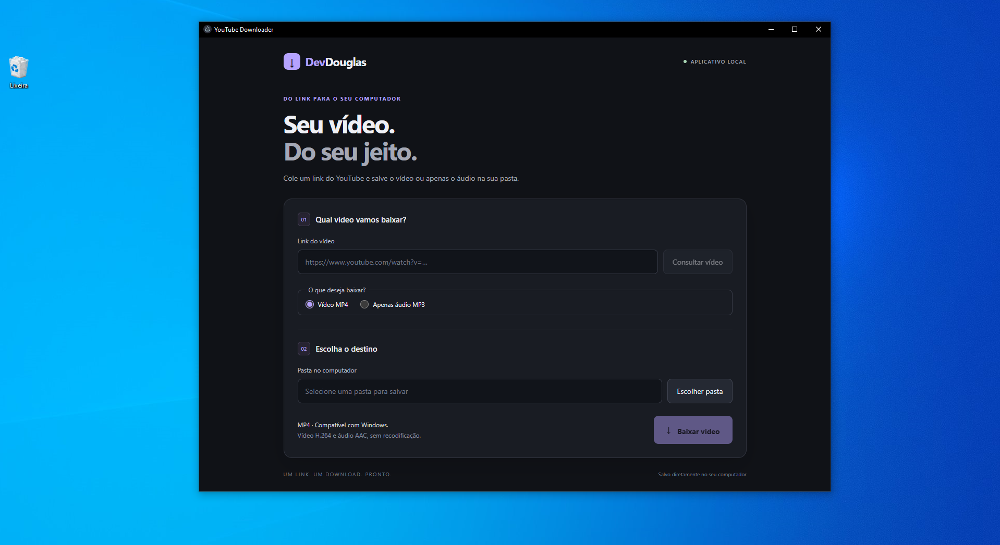

# YouTube Downloader

Aplicativo desktop em português com Electron, React e TypeScript. Consulta um vídeo público do YouTube e baixa áudio e vídeo na qualidade escolhida, com progresso e cancelamento.

Escolha **Vídeo MP4** para salvar áudio e imagem juntos, ou **Apenas áudio MP3** para extrair somente o som. No modo MP3, a resolução não se aplica: o app baixa a melhor faixa de áudio disponível e a converte com FFmpeg em MP3 de alta qualidade (VBR, qualidade 0). A conversão é com perdas e não melhora a qualidade da fonte. Áudio também pode ser extraído quando não existe uma versão de vídeo H.264 compatível.

## Imagem



## Executar no Windows

1. Instale Node.js 22.18+ (ou uma versão LTS posterior compatível).
2. Na raiz do projeto, execute `npm install` (ou `npm ci` para reproduzir o lockfile).
3. Prepare os quatro executáveis seguindo [resources/bin/README.md](resources/bin/README.md). No Windows x64, você pode executar `powershell -NoProfile -File scripts/setup-tools.ps1` para baixá-los com verificação SHA256.
4. Execute `npm run tools:check`.
5. Execute `npm run dev`.

### Preparação do Electron (Windows e Linux)

O comando `npm run dev` executa automaticamente `predev` (`install-electron`) antes de iniciar o Vite. Essa etapa baixa o binário da versão instalada do Electron quando necessário e exige acesso à internet no primeiro uso. Se o binário já estiver instalado, a etapa termina sem repetir o download.

Para preparar somente o Electron, execute `npm run predev`. No Linux, execute o aplicativo em uma sessão gráfica e prepare as ferramentas seguindo [resources/bin/README.md](resources/bin/README.md).

Cole uma URL HTTPS do YouTube, clique em **Consultar vídeo**, escolha a qualidade e a pasta e clique em **Baixar vídeo**. O arquivo final é **MP4 com vídeo H.264 e áudio AAC**, compatíveis com os codecs nativos dos players do Windows. Apenas mudar o contêiner para MP4 não garante reprodução: AV1, VP9 ou outros codecs podem exigir extensões. O aplicativo seleciona diretamente as faixas H.264/AAC e usa FFmpeg para combiná-las, sem recodificação. A lista mostra somente resoluções compatíveis; “Melhor disponível” usa a melhor delas, que pode ser menor que a máxima oferecida pelo YouTube. Quando não existem formatos compatíveis, o aplicativo informa o erro, sem baixar codecs alternativos. Arquivos baixados antes dessa correção precisam ser baixados novamente. O progresso é do arquivo atual: pode reiniciar quando o download passa do vídeo para o áudio. O processamento e a cópia final têm progresso indeterminado.

O nome inclui título e ID do vídeo. Arquivos existentes são preservados, com sufixos `(1)`, `(2)` etc. A gravação final não pode ser interrompida depois que começou; ao cancelar nessa etapa o app aguarda a conclusão. Fechar a janela cancela os processos ativos e aguarda a limpeza antes de encerrar.

## Comandos

| Comando | Finalidade |
| --- | --- |
| `npm run dev` | Inicia Electron e Vite, com atualização durante o desenvolvimento |
| `npm run typecheck` | Verifica TypeScript em modo estrito |
| `npm run lint` | Analisa o código sem reescrever arquivos |
| `npm test` | Executa testes locais, sem acesso ao YouTube |
| `npm run build` | Verifica tipos e compila para `out/` |
| `npm run preview` | Abre o aplicativo compilado; executar build antes |
| `npm run tools:check` | Verifica ferramentas e registra versões locais |
| `npm run smoke` | Abre o build compilado e verifica React, CSS, preload e IPC; fecha automaticamente |

## Arquitetura

```text
src/main/            Janela, ciclo de vida, IPC e serviços de download
src/preload/         Ponte tipada, exposta por contextBridge
src/renderer/src/    React: componentes, hook de estado e estilos
src/shared/          Contratos e canais da comunicação
resources/bin/       Executáveis locais e registro de versões
scripts/             Diagnóstico das ferramentas
tests/               Regras, processos e arquivos temporários
```

React chama apenas `window.downloader`. A API oferece `inspectVideo`, `chooseDirectory`, `startDownload`, `cancelDownload` e `onDownloadEvent`; chamadas retornam `{ ok, value }` ou `{ ok: false, error }`. `startDownload` recebe URL, pasta e `mode`: `video` exige `quality` (`best` ou altura disponível), enquanto `audio` gera MP3 sem resolução. A consulta informa `qualities` compatíveis e `hasAudio`. Inscrições em eventos devolvem uma função de remoção. O processo principal valida URLs, modo, qualidade, pasta escolhida e origem IPC. O preload não expõe Node.js, Electron ou IPC genérico.

O serviço permite uma operação por vez, inclusive consultas, compartilhada pelos dois modos. Executa yt-dlp sem shell e ignora configurações externas, com tentativas e timeout de rede limitados. O yt-dlp usa Deno para os desafios JavaScript e FFmpeg para juntar as faixas no modo vídeo ou converter áudio para MP3. A janela carrega somente a interface local, com isolamento, sandbox, CSP e permissões negadas.

Cada download usa uma pasta exclusiva em `%TEMP%/youtube-downloader`. O arquivo concluído é copiado com criação exclusiva para o destino; a pasta temporária é removida antes do evento final. No Windows o cancelamento encerra a árvore de processos, incluindo FFmpeg. Falhas de limpeza ficam no terminal; se o computador ou processo for encerrado à força, podem restar temporários nesse diretório. Não há retomada após reiniciar.

## Diagnóstico e limitações

- **`Error: Electron uninstall`:** o `electron-vite` não encontrou o binário do Electron. Execute `npm run predev` e depois `npm run dev`. Se o pacote npm estiver ausente, execute `npm ci` antes. O instalador cria `node_modules/electron/path.txt` e o executável em `node_modules/electron/dist`; falhas de download aparecem no terminal. Use `npm run dev` para executar a preparação automática, em vez de chamar `electron-vite dev` diretamente.
- **Ferramenta ausente:** execute `npm run tools:check`; confirme os quatro executáveis diretamente em `resources/bin` ou no PATH.
- **YouTube mudou ou erro de desafio:** atualize yt-dlp e Deno. Use o executável oficial do yt-dlp com EJS incluído. Detalhes técnicos aparecem no terminal que iniciou o app.
- **Falha de rede:** confirme a conexão e tente consultar novamente. Erros do YouTube ou bloqueios de IP podem impedir downloads mesmo com a aplicação funcionando.
- **Pasta sem permissão/disco cheio:** escolha outra pasta ou libere espaço. É necessário espaço para o temporário e a cópia final.
- **Vídeo restrito:** esta versão não usa login, cookies ou credenciais; vídeos privados, restritos ou transmissões em andamento não são suportados.

Sem instalador, fila, histórico ou atualização automática. Links com vídeo e playlist são normalizados para baixar apenas o item indicado, no modo escolhido. A compatibilidade real com o YouTube depende do vídeo e das ferramentas instaladas. Utilize conteúdo próprio ou autorizado.

## Verificação manual

Após os checks automatizados, abra `dev` e `preview` e confira:

- Consulta de uma URL `watch`, `youtu.be` e Shorts; rejeição de canal, playlist isolada e domínio parecido.
- Vídeo com áudio e vídeo separados: verificar reprodução do arquivo final e resolução escolhida.
- Alternar entre vídeo e áudio: MP3 sem controle de resolução, conversão, reprodução do som e cancelamento durante o processamento. Confirmar que arquivos existentes são preservados nos dois modos.
- Pasta com espaços e acentos; baixar duas vezes preservando o primeiro arquivo.
- Cancelar durante download e combinação; verificar ausência de processos órfãos e temporários.
- Ferramenta removida, vídeo indisponível, interrupção de rede e pasta sem permissão: mensagem compreensível e possibilidade de tentar novamente.

Os testes automatizados usam processos/saídas simulados e arquivos locais; não comprovam disponibilidade de um vídeo no YouTube.

Para executar os testes opcionais com YouTube e ferramentas reais no PowerShell, defina `$env:LIVE_VIDEO_URL = 'URL_HTTPS_DO_VIDEO'` e execute `npm exec vitest -- run tests/live.test.ts`. Eles baixam MP4 na menor resolução compatível e MP3, verificam contêiner e codecs com ffprobe, verificam cancelamento de subprocessos e removem os arquivos de teste. Remova a variável com `Remove-Item Env:LIVE_VIDEO_URL` ao terminar. Esses testes ficam desabilitados na suíte normal.
